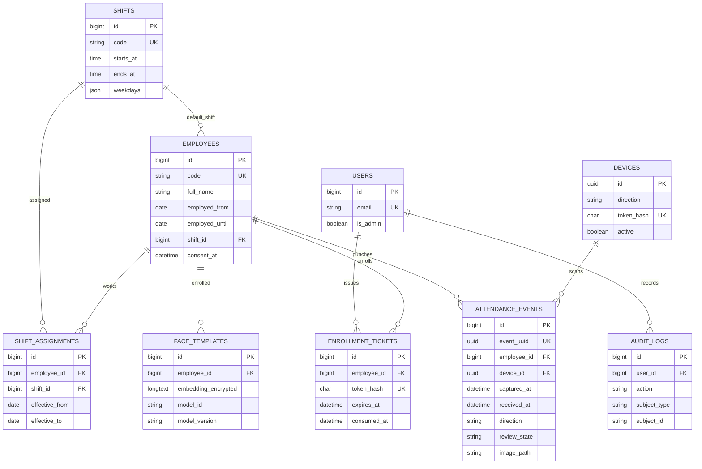

# Sơ đồ dữ liệu (mức logic)

Giờ trong `DATETIME` MySQL lưu theo **UTC**. Các báo cáo đổi sang `Asia/Ho_Chi_Minh` khi hiển thị. Vector mã hóa dùng Eloquent cast `encrypted:array` và phụ thuộc APP_KEY.
